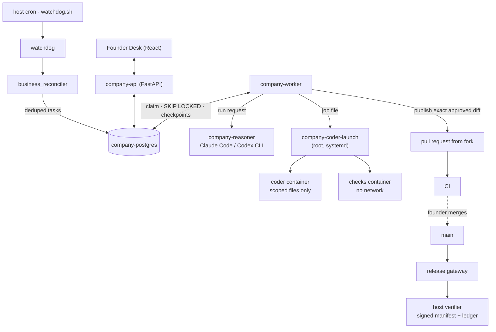

## Overview

Seerxo OS is the system I use to run Seerxo, a one-founder company. It is a FastAPI service over
PostgreSQL that stores the company's operational state — goals, tasks, events, incidents,
approvals, metrics — decides *without a model call* whether there is work to do, hands eligible
work to AI coding CLIs (Claude Code and Codex) under strict boundaries, and records every outcome
so the next session starts from facts instead of a fresh context window.

The organising principle, from the project README: **the company must remember even when the AI
forgets.** Models are replaceable workers. PostgreSQL holds operational state, Git holds policy,
and a conversation is temporary.

## The problem

Before this system, every model run was attended: I started an agent on a laptop, watched it, and
carried context between sessions by hand. Making that unattended raises four engineering problems
that prompt design alone does not solve:

1. **Memory.** Anything that lives only in a context window is lost at the next session.
2. **Triggering.** If a model decides whether work exists, cost and behaviour become unpredictable.
3. **Isolation.** An agent that writes code must not be able to reach credentials, the database or
   production.
4. **Authorisation.** Agent output must never reach production without independent review and an
   explicit, verifiable human decision.

## System architecture

The deployment is a Docker Compose stack on a single host: `company-postgres`, `company-api`,
`company-worker`, `company-reasoner`, `company-review-signer` and two egress proxies, with a
`cloudflared` tunnel in front of the API. Each service has its own build target with base images
pinned by digest.

## Core components

**Operational memory.** PostgreSQL via SQLAlchemy 2, evolved through 12 Alembic migrations (tasks,
events, agent execution state, notebook memory, metric observations, experiments, notification
state). CI asserts that there is exactly one migration head. Policy — agent registry, cost policy,
release policy, coder profiles — is versioned in Git, not in the database.

**Deterministic work detection.** A host cron job runs the watchdog every ten minutes; the watchdog
calls the business reconciler. The reconciler compares goals with measured metrics and emits at
most one open task per goal and rule (`GOAL_BEHIND`, `GOAL_UNMEASURED`, `GOAL_NO_WORK`, …), deduplicated by a
partial unique index on `dedupe_key` over open tasks. *No work means no model call.*

**Worker.** `company-worker` polls every 60 seconds and claims tasks atomically with
`SELECT … FOR UPDATE SKIP LOCKED`. Every run writes an `agent_runs` row, events and an audit
record. Tasks move `READY → IN_PROGRESS → REVIEW`; the worker never marks work `DONE` — closing a
task is a human decision.

**Reasoner.** Model CLIs run in a separate `company-reasoner` container that has no database URL,
GitHub token or messaging token. Providers are tried in registry order and each reports a health
state (`QUOTA_EXHAUSTED`, `RATE_LIMITED`, `METERED_BLOCKED`); a provider in trouble cools down for
30 minutes.

**Isolated code changes ("Stage C").** A root-owned launcher on the host starts one container per
request from two fixed profiles: *code* and *checks*. The worker never receives the Docker socket
and cannot add mounts, environment variables, flags or images. The coder edits an export of an
explicitly whitelisted set of files with no Git metadata or credentials; checks run with no
network.

**Signed release gateway.** Releases are authorised with SSH signatures (`ssh-keygen -Y sign`)
under separate keys for the founder, the gateway and the reviewer. A host-side verifier performs
verify → apply → record under a single `flock`, with sequence numbers, an append-only ledger and a
`pending` marker that blocks further releases after a crash.

## Design decisions

| Decision | Why | Cost |
| --- | --- | --- |
| PostgreSQL + a polling container instead of a queue or scheduler product | Atomic claims and state live in one transactional store I already operate | 60 s latency; single host |
| Subscription CLIs only; metered API keys are refused (`METERED_BLOCKED`) and stripped from the child environment | Hitting a quota means *waiting*, never silently paying | Throughput is bounded by subscription limits |
| One coder (Claude), a different provider as reviewer (Codex) | Independent review of the exact diff fingerprint; Codex's own sandbox cannot start inside the hardened coder container, and loosening the container was rejected | Reviewer and coder are not interchangeable |
| Release risk classified by an **allow-list** (`low_risk_paths` is `docs/*` only) | A deny-list protects file names, not behaviour | Almost every release needs the founder's signature |
| No emergency bypass; rollback is a new reviewed revert commit | A bypass is the path an attacker or a confused agent would take | Slower incident response |
| Tests are *tripwires, not boundaries* | The real boundaries are the host verifier, signed policy and credential separation | Tests alone prove nothing about security |

Decisions are recorded in the repository as `DEC-001` … `DEC-008`. One example: development and CI
moved to a public repository with GitHub-hosted runners after private self-hosted CI caused
queueing problems.

## Security and reliability

- **Staged autonomy.** Stage A (observe) is on; Stage B (low-risk, no-tool tasks) is opt-in;
  Stage C (isolated engineering) is off until enabled per task; Stage D (production workflows)
  is not enabled.
- **Human identity.** Only a verified Cloudflare Access assertion counts as the founder. API
  tokens and operators cannot approve on the founder's behalf, and verification fails closed.
- **Exact-diff publication.** Stage C produces a tested diff fingerprint; a different provider
  must approve exactly that fingerprint; a pull request is opened only if the commit equals base
  plus the approved diff. Nothing in this path merges or deploys.
- **CI hardening.** GitHub-hosted runners only, `contents: read` permissions, actions pinned to
  commit SHAs, `persist-credentials: false`, no secrets — enforced by tests. Secret scanning,
  dependency scanning, workflow linting and IaC scanning run as separate workflows.
- **Recovery.** Stale runs are failed and requeued once; retries use 1/5/30-minute backoff with
  identical-error loop detection; a result checkpoint prevents a completed model call from being
  repeated after a crash. Backups are encrypted with `age`, copied off-site, and restored into a
  disposable database weekly.
- **Written threat model.** Each boundary lists its control and whether that control is *tested*
  or an *assumption*. Residual risks are named, including that GitHub settings are not code.

## Testing and validation

The backend uses pytest with xdist; the Founder Desk uses Node's built-in test runner. A static
count finds about 2,100 test functions across 142 backend test files, plus golden-output
evaluations for agent behaviour. Dedicated suites exercise PostgreSQL concurrency and crash
recovery using subprocess crash children, and CI runs a real Docker rehearsal of release recovery.

## Results and evidence

- The API, worker, reconciler, Desk, backups and release gateway run in production for one company
  (per the project README).
- The full design — threat model, release gateway, approval identity, decisions — is documented in
  the public repository and can be checked against the code.

I am deliberately not quoting a pass rate, cost saving or throughput figure: none has been measured
in a way I would publish.

## Limitations

- Single host, single company; no horizontal scaling.
- No automatic merge. Stage D is not enabled. Unattended code changes are off by default.
- The repository's own documents disagree on how far the Stage C pilot went; I treat it as
  **attended, not yet unattended**.
- The public repository starts at an initial public-release commit (October 2026); earlier history
  is in a private repository. There are no tagged releases.
- No licence has been chosen; the source is public to read but all rights are reserved.
- Model review is not proof of correctness, and the tests are tripwires, not a security argument.

## Future directions

- A real unattended Stage C pilot with recorded evidence before widening scope.
- Verified cutover of release duties from the private repository to the public one, under a signed
  procedure.
- Choosing a licence so external contributions become possible.

## References

- Repository: [github.com/Seerxo/seerxo-os](https://github.com/Seerxo/seerxo-os)
- Related research: [Deterministic triggers for agent work](/research/deterministic-agent-triggers/)
