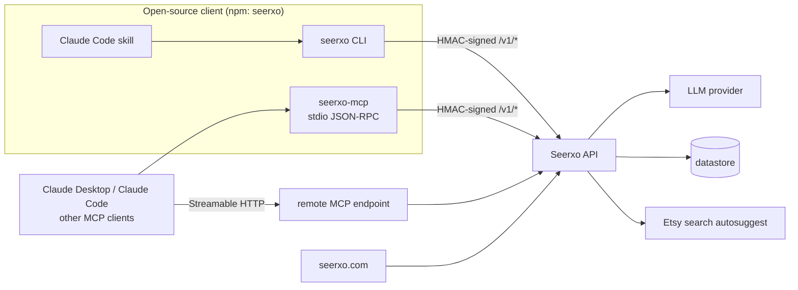

## Overview

Seerxo helps Etsy sellers write listings. Describe a product and it drafts a full listing — title,
A/B title variants, description, 13 tags and Etsy attributes. Give it an existing listing and it
scores it, explains each finding, rewrites it, or suggests keywords.

The same account and credit pool is reachable from several surfaces: a terminal CLI, a local MCP
server for Claude Desktop, Claude Code and other MCP clients, a remote MCP endpoint, a Claude Code
skill/plugin, and the web app at [seerxo.com](https://seerxo.com). The client is open source (MIT,
published to npm as `seerxo`); the business logic runs in a hosted backend that is not public.

## The problem

Etsy listings have strict structural rules, and most advice about "SEO" for them is vague. I wanted
two things that are often conflated to stay separate:

- **Checking** a listing against explicit rules should be deterministic, explainable and free.
- **Writing** a listing is a generative task and costs real money per call.

And it should work where sellers increasingly already are: inside an AI assistant.

## System architecture

Only the client side of this diagram is public. Backend internals are shown at the level the
public repository documents them.

## Core components

**CLI.** `login` (browser approval, then an API key is stored locally), `generate`,
`analyze`/`audit`, `optimize`, `keywords`, `skill add`, an interactive shell and `--json` output
for scripting.

**Local MCP server.** A stdio server speaking newline-delimited JSON-RPC with five tools:
`generate_etsy_seo`, `seerxo_analyze_listing`, `seerxo_optimize_listing`,
`seerxo_suggest_keywords` and `seerxo_quota`.

**Remote MCP.** A Streamable HTTP endpoint listed in the MCP Registry as
`io.github.semihbugrasezer/seerxo`, so hosts can connect without installing anything.

**Claude Code skill.** Uses the MCP tools when they are connected and falls back to the CLI
otherwise. It instructs the agent not to hand-write listings or invent metrics.

**Versioned API.** The client calls `/v1/generate`, `/v1/analyze`, `/v1/optimize` and
`/v1/keywords`. The backend owns business rules, quota and persistence; clients never hold
model-provider keys.

## Design decisions

- **Thin client, server-owned logic.** Quota and rules live in one place and clients hold no AI
  keys. The cost is that nothing works offline.
- **Hand-written MCP over a framework.** The client has two runtime dependencies (`chalk`,
  `open`) and no MCP SDK. That keeps the install and the supply-chain surface small, at the price
  of maintaining protocol-version negotiation by hand.
- **No automatic retry on metered calls.** Retrying a `generate` or `optimize` POST could charge a
  user twice. Instead there is a 120-second timeout, overridable with `SEERXO_TIMEOUT_MS`.
- **stdout is a contract.** While serving MCP, logs go to stderr only. CLI output, tool schemas
  and exit codes are treated as compatibility contracts; deprecated fields such as `seoScore` are
  kept as aliases.
- **Deterministic audit, metered generation.** `analyze` is rule-based, returns versioned rule IDs
  with a severity and a fix for each finding, and is unlimited on the free tier. Its schema carries
  a `limitations` field and states that the 0–100 score is *not a rank or sales prediction*, so
  agents relaying it cannot overclaim.

## Security and reliability

- Each API request is signed with HMAC-SHA256 over the JSON payload and a timestamp.
- The local credentials file is written with `0700` directory and `0600` file permissions; the
  README states plainly that it is plaintext.
- CI actions are pinned by SHA; `npm audit` gates high-severity production advisories; OSV-Scanner
  and OpenSSF Scorecard run weekly; Dependabot is enabled.

## How it was built — my role

- The public repository has 185 commits since 2025-11-29. 106 are authored by me; the rest come
  from release automation, Dependabot, the Jules bot (16), one outside contributor and one
  `seerxo-agent` commit.
- 26 commits carry a Claude co-author trailer. AI assistants help with implementation; product
  direction, the public contracts and releases are mine. A trailer means *co-authored*, not
  *written entirely by a model*.
- The backend and web app are private, so only the client side can be checked here.

## Testing and validation

`node --test` with `esmock`: 103 test cases in 18 files (static count), including an end-to-end
test of the stdio MCP server and fixed HMAC signature fixtures. CI runs tests, syntax checks and a
package-contents check on Node 18, 20 and 22.

Releases are automated: semantic-release publishes to npm and GitHub Releases on every merge to
`main`, then updates the MCP Registry entry through GitHub OIDC with no long-lived secret.

## Engineering evidence

All links point at commit `8c52984`.

| What | Where |
| --- | --- |
| MCP tool schemas, including `limitations` and score caveats | [`src/mcp/tools.js`](https://github.com/semihbugrasezer/seerxo/blob/8c529841efc37ebb999500bd1b7e5bbfaba9e985/src/mcp/tools.js) |
| Hand-written stdio JSON-RPC server, HMAC signing, no-retry policy | [`mcp-server.js`](https://github.com/semihbugrasezer/seerxo/blob/8c529841efc37ebb999500bd1b7e5bbfaba9e985/mcp-server.js) |
| End-to-end test of the stdio MCP server | [`tests/stdio-mcp.test.js`](https://github.com/semihbugrasezer/seerxo/blob/8c529841efc37ebb999500bd1b7e5bbfaba9e985/tests/stdio-mcp.test.js) |
| Agent skill that forbids invented metrics | [`skills/seerxo-etsy-seo/SKILL.md`](https://github.com/semihbugrasezer/seerxo/blob/8c529841efc37ebb999500bd1b7e5bbfaba9e985/skills/seerxo-etsy-seo/SKILL.md) |
| Contract rules for contributors and agents | [`AGENTS.md`](https://github.com/semihbugrasezer/seerxo/blob/8c529841efc37ebb999500bd1b7e5bbfaba9e985/AGENTS.md) |
| CI matrix and automated releases | [`ci.yml`](https://github.com/semihbugrasezer/seerxo/blob/8c529841efc37ebb999500bd1b7e5bbfaba9e985/.github/workflows/ci.yml), [`release.yml`](https://github.com/semihbugrasezer/seerxo/blob/8c529841efc37ebb999500bd1b7e5bbfaba9e985/.github/workflows/release.yml) |
| Published releases | [GitHub Releases](https://github.com/semihbugrasezer/seerxo/releases), [npm](https://www.npmjs.com/package/seerxo) |

## What this project demonstrates about my AI engineering skills

- **Shipping an LLM product end to end.** A live service with several client surfaces, one account
  and one credit pool, and automated releases to npm and the MCP Registry.
- **Designing tools for agents.** Tool schemas carry explicit `limitations` and state that the score
  is *not a rank or sales prediction*, so an agent relaying results cannot overclaim.
- **Deterministic validation next to generation.** The rule-based audit is free and explainable;
  generation is metered and kept separate.
- **API contracts.** Versioned endpoints, signed requests, stdout treated as a protocol, and
  deprecated fields kept as aliases.
- **Cost-aware failure handling.** Metered calls are never retried automatically, so a timeout
  cannot charge a user twice.

## Results and evidence

- Live at [seerxo.com](https://seerxo.com); the API health endpoint responded on 2026-10-31.
- 30 GitHub releases, 33 npm versions, 28 GitHub stars and 7 forks (measured 2026-10-31).

I do not publish user, revenue or conversion figures here. Stars and download counts are not user
counts.

## Limitations

- The backend and web frontend are closed source; only the client is open.
- The most recent weekly OSV-Scanner run (2026-10-26) failed and needs attention.
- The committed `server.json` lags the published version; CI rewrites it only at release time.

## Future directions

- Fix the failing dependency-scan run and keep the registry manifest in sync with releases.
- Extend the deterministic audit with more versioned rules before adding more generation.

## References

- Repository: [github.com/semihbugrasezer/seerxo](https://github.com/semihbugrasezer/seerxo)
- Package: [npmjs.com/package/seerxo](https://www.npmjs.com/package/seerxo)
- Product: [seerxo.com](https://seerxo.com)
