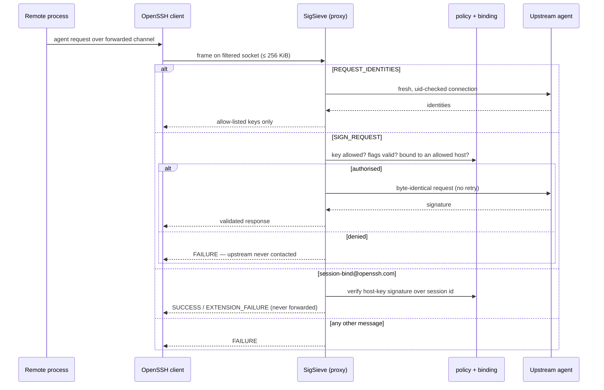

## Overview

SigSieve sits between your SSH client and your existing agent. It exposes a second, filtered
agent socket that you forward to remote hosts. Only identities you allow-list by SHA-256
fingerprint are visible through it, and only those can be asked to sign. Private keys never move:
SigSieve forwards authorised requests byte-for-byte to the upstream agent, which still does the
signing (and, for Secretive, still owns the Touch ID prompt).

> **Status.** Experimental security software. Not independently audited. The reviews so far were
> internal, AI-assisted reviews run in separate contexts — not an external audit.

## The problem

Agent forwarding is convenient and dangerous. A remote process that can reach the forwarded socket
can use *every* identity in your agent. Hardware backing prevents key extraction; it does not
prevent a compromised host from requesting signatures.

The usual mitigations do not cover one important case. ProxyJump avoids forwarding entirely; a
second `ssh-agent` with only selected keys works for files on disk; OpenSSH destination
constraints (`ssh-add -h`) apply to keys you can add to an agent. A **non-exportable** key — such
as a Secure Enclave key managed by Secretive — cannot be copied into another agent at all.
SigSieve filters the agent you already have instead of replacing it.

## System architecture

The login itself still uses the unfiltered agent (`IdentityAgent`); only the forwarded socket
(`ForwardAgent=<filtered socket>`) goes through SigSieve. The upstream socket is never taken from
`SSH_AUTH_SOCK`; it must be given explicitly with `--upstream` or `--secretive`.

## Core components

| Module | Responsibility |
| --- | --- |
| `protocol.rs` | Frame I/O and a bounds-checked reader |
| `keys.rs` | Key-blob validation and fingerprints |
| `policy.rs` | Immutable allow-list and destination set |
| `binding.rs` | Verified `session-bind` state and host-key signature checks |
| `proxy.rs` | `handle_request` — the only dispatcher |
| `proxy/resources.rs` | Budgets, FIFO permits, digest cache |
| `upstream.rs` | A fresh, uid-checked upstream connection per request |
| `socket.rs` | All `unsafe` OS calls, in one place |

The dispatcher understands exactly three message types: `REQUEST_IDENTITIES` (11),
`SIGN_REQUEST` (13) and `EXTENSION` (27). Everything else — adding or removing identities,
smart-card operations, lock/unlock, constrained adds and all unknown types — is answered with a
local failure and never forwarded. The test suite checks all 256 message type values.

### Verified destination binding

With `--allow-destination`, SigSieve uses OpenSSH's `session-bind@openssh.com` extension. The
destination host key must have signed the session identifier (Ed25519 and ECDSA P-256/384/521 are
verified; RSA host keys are refused). Signatures are produced only for well-formed user
authentication whose session identifier equals the latest authentication binding, and only for
`publickey-hostbound` requests. Enforcement lives inside SigSieve, so the upstream agent does not
need to support destination constraints.

## Design decisions

- **Fail closed everywhere.** Unknown operations, malformed frames, missing hostbound support, RSA
  host keys and keys that carry their own upstream destination constraints are all refused.
- **Own parser, byte-exact forwarding.** A small bounds-checked parser decides; the authorised
  request is forwarded exactly as received rather than decoded and re-encoded. `ssh-agent-lib`
  was rejected because it brings an async runtime and a wider parsing surface; `ssh-key` was
  avoided to keep the `rsa` crate out of the dependency tree.
- **No async runtime.** One thread per connection with a registry cap, chosen for auditability.
- **`unsafe` in one file.** All 22 `unsafe` sites are libc calls in `src/socket.rs`;
  `#![forbid(unsafe_op_in_unsafe_fn)]` is set crate-wide.
- **No upstream retries.** A retry could trigger a second Touch ID prompt for one user action.
- **Bounded resources.** 256 KiB frame cap checked before allocation, 10 s per-frame deadline,
  32 clients, 4 concurrent upstream exchanges, and a signing budget of 32 that refills at 4/s.
- **Refuse rather than analyse risky SSH configuration.** `connect` rejects a non-`-W`
  `ProxyCommand`, `Match exec`, `PermitLocalCommand yes`, `StrictHostKeyChecking=no` and X11
  forwarding.

## Threat model

**Considered attackers:** malicious remote root, a compromised remote account, a raw
agent-protocol client, signing with a known public key, repeated or concurrent signing, extension
manipulation, `session-bind` replay, multi-hop setups, ControlMaster reuse, environment and
socket-path substitution, symlink races and denial of service.

**Trusted:** the local account, the kernel, the upstream agent and the first-hop SSH client.

**Explicitly not defended:** misuse of an *allowed* key while forwarding is active; a compromised
local machine, account or upstream agent; a compromised host key at an allowed destination; timing
side channels. An attacker can still exhaust one instance's budgets (residual denial of service).

## Testing and validation

The suite is layered: unit tests, property tests (proptest), integration tests against a mock agent
with hostile modes, CLI tests on the real binary, tests against real OpenSSH tools, and end-to-end
tests that start a throwaway `sshd`. Four cargo-fuzz targets (`requests`, `session_bind`,
`key_blob`, `upstream_reply`) run under libFuzzer with AddressSanitizer.

- **Local run (2026-10-31, macOS arm64, `cargo test --offline`):** 159 passed, 0 failed,
  2 ignored. The 11 `sshd` end-to-end tests also passed with `SIGSIEVE_REQUIRE_SSHD=1`, which turns
  missing prerequisites into failures instead of skips.
- **Fuzzing (release commit `fc7484b`):** one hour per target, about 313 million executions, no
  crashes or sanitizer findings. The project states plainly that this is not proof of the absence
  of vulnerabilities.
- **CI:** formatting, `clippy -D warnings`, debug and release tests on macOS arm64, Ubuntu 24.04
  x86_64 and arm64, an MSRV job, `cargo audit`, `cargo deny` and secret scanning.
- **Traceability:** the security model lists 20 numbered invariants and maps each to named tests;
  a findings register records 42 internal findings and how each was resolved or accepted.

## Limitations

- Experimental and not independently audited.
- Real Secretive testing so far: one owner-assisted run with one P-256 key against two local SSH
  servers. Secretive version and Touch ID prompt counts were not recorded.
- Binding mode is unverified end-to-end against GitHub; GitLab.com and Bitbucket Cloud did not
  advertise hostbound authentication when measured (2026-10-27).
- Binding mode forbids non-authentication signing such as `git commit -S`.
- No OpenSSH certificates, no legacy SHA-1 `ssh-rsa`, no Windows or Intel-macOS validation; no
  Homebrew, crates.io or notarised builds.

## Future directions

- An external review before any non-experimental release.
- Broader hardware coverage (1Password, FIDO security keys) with recorded evidence.
- Tagging the next pre-release (`0.1.0-alpha.3` is in `Cargo.toml` but not yet tagged).

## References

- Repository: [github.com/semihbugrasezer/sigsieve](https://github.com/semihbugrasezer/sigsieve)
- Release: [v0.1.0-alpha.2 (pre-release)](https://github.com/semihbugrasezer/sigsieve/releases/tag/v0.1.0-alpha.2)
- Related research: [Threat-modelling SSH agent forwarding](/research/ssh-agent-forwarding-threat-model/)
