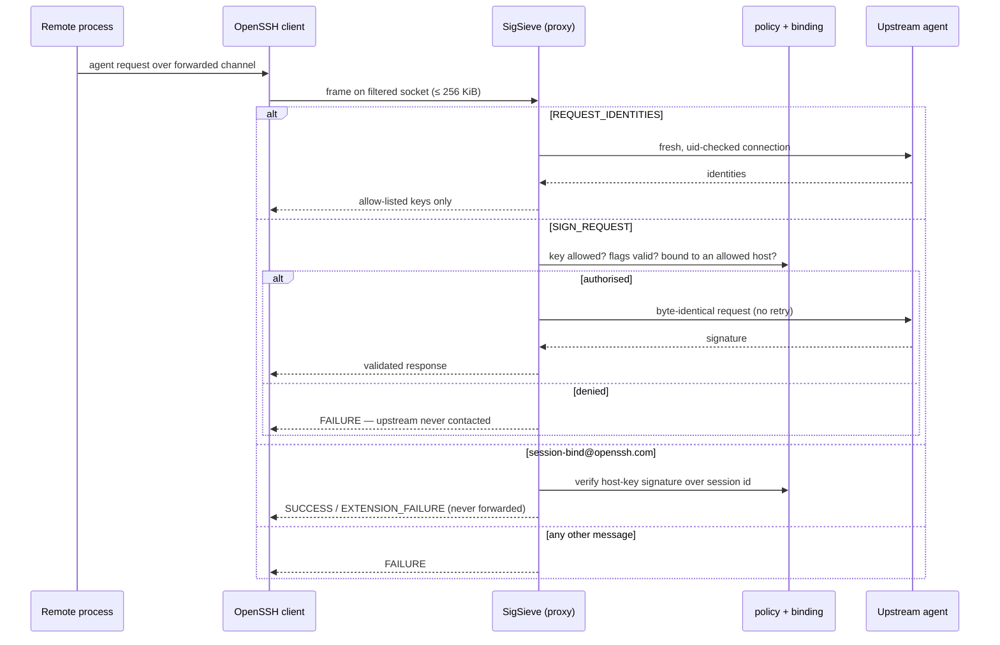

## Overview

SigSieve sits between your SSH client and your existing agent. It exposes a second, filtered
agent socket that you forward to remote hosts. Only identities you allow-list by SHA-256
fingerprint are visible through it, and only those can be asked to sign. Private keys never move:
SigSieve forwards authorised requests byte-for-byte to the upstream agent, which still does the
signing (and, for Secretive, still owns the Touch ID prompt).

> **Status.** Experimental security software. Not independently audited. The reviews so far were
> internal, AI-assisted reviews run in separate contexts — not an external audit.

## Current release and installation

The published experimental release is **v0.1.0-alpha.4**, pinned to source commit
[`5ea37b7`](https://github.com/semihbugrasezer/sigsieve/commit/5ea37b73ce7ed5dd33f3ac405c3ae4ad4da68751).
Prebuilt archives cover macOS Apple Silicon and Linux x86_64 (Ubuntu 24.04 / glibc 2.39 baseline).
The [installation guide](https://github.com/semihbugrasezer/sigsieve/blob/5ea37b73ce7ed5dd33f3ac405c3ae4ad4da68751/docs/INSTALL.md)
checks archive checksums, a separately pinned SHA-256 digest and GitHub build provenance.

On macOS, the [Homebrew tap](https://github.com/semihbugrasezer/homebrew-sigsieve) provides a source build:

```sh
brew install semihbugrasezer/sigsieve/sigsieve
```

The tap verifies the source archive checksum; that is separate from prebuilt-binary provenance.
It has been tested on Apple Silicon only. Linux arm64 is CI-tested and source-only.
The [synthetic-key quickstart](https://github.com/semihbugrasezer/sigsieve/blob/5ea37b73ce7ed5dd33f3ac405c3ae4ad4da68751/docs/QUICKSTART.md)
lets developers try the workflow without their own agent or remote hosts.

## The problem

Agent forwarding is convenient and dangerous. A remote process that can reach the forwarded socket
can use *every* identity in your agent. Hardware backing prevents key extraction; it does not
prevent a compromised host from requesting signatures.

The usual mitigations do not cover one important case. ProxyJump avoids forwarding entirely; a
second `ssh-agent` with only selected keys works for files on disk; OpenSSH destination
constraints (`ssh-add -h`) apply to keys you can add to an agent. A **non-exportable** key — such
as a Secure Enclave key managed by Secretive — cannot be copied into another agent at all.
SigSieve filters the agent you already have instead of replacing it.

## System architecture



The login itself still uses the unfiltered agent (`IdentityAgent`); only the forwarded socket
(`ForwardAgent=<filtered socket>`) goes through SigSieve. The upstream socket is never taken from
`SSH_AUTH_SOCK`; it must be given explicitly with `--upstream` or `--secretive`.

## Core components

| Module | Responsibility |
| --- | --- |
| `protocol.rs` | Frame I/O and a bounds-checked reader |
| `keys.rs` | Key-blob validation and fingerprints |
| `policy.rs` | Immutable allow-list and destination set |
| `binding.rs` | Verified `session-bind` state and host-key signature checks |
| `proxy.rs` | `handle_request` — the only dispatcher |
| `proxy/resources.rs` | Budgets, FIFO permits, digest cache |
| `upstream.rs` | A fresh, uid-checked upstream connection per request |
| `socket.rs` | All `unsafe` OS calls, in one place |

The dispatcher understands exactly three message types: `REQUEST_IDENTITIES` (11),
`SIGN_REQUEST` (13) and `EXTENSION` (27). Everything else — adding or removing identities,
smart-card operations, lock/unlock, constrained adds and all unknown types — is answered with a
local failure and never forwarded. The test suite checks all 256 message type values.

### Verified destination binding

With `--allow-destination`, SigSieve uses OpenSSH's `session-bind@openssh.com` extension. The
destination host key must have signed the session identifier (Ed25519 and ECDSA P-256/384/521 are
verified; RSA host keys are refused). Signatures are produced only for well-formed user
authentication whose session identifier equals the latest authentication binding, and only for
`publickey-hostbound` requests. Enforcement lives inside SigSieve, so the upstream agent does not
need to support destination constraints.

## Design decisions

- **Fail closed everywhere.** Unknown operations, malformed frames, missing hostbound support, RSA
  host keys and keys that carry their own upstream destination constraints are all refused.
- **Own parser, byte-exact forwarding.** A small bounds-checked parser decides; the authorised
  request is forwarded exactly as received rather than decoded and re-encoded. `ssh-agent-lib`
  was rejected because it brings an async runtime and a wider parsing surface; `ssh-key` was
  avoided to keep the `rsa` crate out of the dependency tree.
- **No async runtime.** One thread per connection with a registry cap, chosen for auditability.
- **`unsafe` in one file.** OS calls are isolated in `src/socket.rs`;
  `#![forbid(unsafe_op_in_unsafe_fn)]` is set crate-wide.
- **No upstream retries.** A retry could trigger a second Touch ID prompt for one user action.
- **Bounded resources.** 256 KiB frame cap checked before allocation, 10 s per-frame deadline,
  32 clients, 4 concurrent upstream exchanges, and a signing budget of 32 that refills at 4/s.
- **Refuse rather than analyse risky SSH configuration.** `connect` rejects a non-`-W`
  `ProxyCommand`, `Match exec`, `PermitLocalCommand yes`, `StrictHostKeyChecking=no` and X11
  forwarding.

## How it was built — my role

- I use AI coding assistants for implementation and for review in separate contexts; the findings
  register documents that process. These internal reviews are not an independent security audit.
- The threat model, security invariants, limitations and release decisions are documented in the
  repository and maintained by me.

## Difficult problems (from the findings register)

Every finding is recorded with its fix in [`docs/FINDINGS.md`](https://github.com/semihbugrasezer/sigsieve/blob/5ea37b73ce7ed5dd33f3ac405c3ae4ad4da68751/docs/FINDINGS.md). Three of the
documented findings show where the hard part actually was — not the agent protocol, but the SSH
client configuration around it:

- **F-01 — ControlMaster reuse** could forward the *unfiltered* agent through an existing
  multiplexed connection. Fixed.
- **F-02 — indirect `ProxyCommand`** (environment variables, `sh -c`, wrappers) could forward the
  unfiltered agent. Fixed by failing closed.
- **F-29 — unverified proxy hops**: a wrapper on a `ProxyJump` hop ran with the unfiltered login
  agent in its environment. Fixed: every hop is verified.

The lesson the repository draws is the design rule above: refuse SSH configurations that cannot be
verified, rather than try to analyse them.

## Threat model

**Considered attackers:** malicious remote root, a compromised remote account, a raw
agent-protocol client, signing with a known public key, repeated or concurrent signing, extension
manipulation, `session-bind` replay, multi-hop setups, ControlMaster reuse, environment and
socket-path substitution, symlink races and denial of service.

**Trusted:** the local account, the kernel, the upstream agent and the first-hop SSH client.

**Explicitly not defended:** misuse of an *allowed* key while forwarding is active; a compromised
local machine, account or upstream agent; a compromised host key at an allowed destination; timing
side channels. An attacker can still exhaust one instance's budgets (residual denial of service).

## Testing and validation

The suite is layered: unit tests, property tests (proptest), integration tests against a mock agent
with hostile modes, CLI tests on the real binary, tests against real OpenSSH tools, and end-to-end
tests that start a throwaway `sshd`. Four cargo-fuzz targets (`requests`, `session_bind`,
`key_blob`, `upstream_reply`) run under libFuzzer with AddressSanitizer.

- **Alpha.4 candidate CI:** Rust tests and real OpenSSH integration, including platform-specific
  checks, are recorded in the [candidate run](https://github.com/semihbugrasezer/sigsieve/actions/runs/41519403249).
- **Linux cross-user restriction:** a [separate run](https://github.com/semihbugrasezer/sigsieve/actions/runs/41519403122)
  exercises peer credentials and its negative test. It does not establish macOS cross-user behavior.
- **Alpha.4 fuzz campaign:** four targets, one hour each, with 287,516,615 reported executions and
  no reported crash in the [recorded campaign](https://github.com/semihbugrasezer/sigsieve/actions/runs/41527783557).
  This is not proof of the absence of vulnerabilities.
- **Distribution:** the [release build](https://github.com/semihbugrasezer/sigsieve/actions/runs/41538765784)
  publishes archives, SHA-256 checksums, CycloneDX SBOMs and provenance attestations;
  [Linux release verification](https://github.com/semihbugrasezer/sigsieve/actions/runs/41540423408)
  is recorded separately.

These are the project's published evidence records, not tests rerun for this portfolio update.
They apply to release commit `5ea37b7`, not every later commit on `main`.

## Engineering evidence

Source links below point at the alpha.4 release commit `5ea37b7`.

| What | Where |
| --- | --- |
| The only request dispatcher | [`src/proxy.rs`](https://github.com/semihbugrasezer/sigsieve/blob/5ea37b73ce7ed5dd33f3ac405c3ae4ad4da68751/src/proxy.rs) |
| Bounds-checked protocol parsing | [`src/protocol.rs`](https://github.com/semihbugrasezer/sigsieve/blob/5ea37b73ce7ed5dd33f3ac405c3ae4ad4da68751/src/protocol.rs) |
| Destination binding verification | [`src/binding.rs`](https://github.com/semihbugrasezer/sigsieve/blob/5ea37b73ce7ed5dd33f3ac405c3ae4ad4da68751/src/binding.rs) |
| All `unsafe` code, in one module | [`src/socket.rs`](https://github.com/semihbugrasezer/sigsieve/blob/5ea37b73ce7ed5dd33f3ac405c3ae4ad4da68751/src/socket.rs) |
| Threat model and security invariants | [`THREAT_MODEL.md`](https://github.com/semihbugrasezer/sigsieve/blob/5ea37b73ce7ed5dd33f3ac405c3ae4ad4da68751/docs/THREAT_MODEL.md), [`SECURITY_MODEL.md`](https://github.com/semihbugrasezer/sigsieve/blob/5ea37b73ce7ed5dd33f3ac405c3ae4ad4da68751/docs/SECURITY_MODEL.md) |
| Findings register | [`docs/FINDINGS.md`](https://github.com/semihbugrasezer/sigsieve/blob/5ea37b73ce7ed5dd33f3ac405c3ae4ad4da68751/docs/FINDINGS.md) |
| End-to-end tests with a real `sshd` | [`tests/e2e_sshd.rs`](https://github.com/semihbugrasezer/sigsieve/blob/5ea37b73ce7ed5dd33f3ac405c3ae4ad4da68751/tests/e2e_sshd.rs) |
| Fuzz targets | [`fuzz/fuzz_targets/`](https://github.com/semihbugrasezer/sigsieve/tree/5ea37b73ce7ed5dd33f3ac405c3ae4ad4da68751/fuzz/fuzz_targets) |
| Test strategy | [`docs/TESTING.md`](https://github.com/semihbugrasezer/sigsieve/blob/5ea37b73ce7ed5dd33f3ac405c3ae4ad4da68751/docs/TESTING.md) |
| CI matrix | [`.github/workflows/ci.yml`](https://github.com/semihbugrasezer/sigsieve/blob/5ea37b73ce7ed5dd33f3ac405c3ae4ad4da68751/.github/workflows/ci.yml) |

## What this project demonstrates

SigSieve is security and systems engineering, not an AI project. It shows the habits I bring to AI
infrastructure: a threat model written before the code, least privilege, fail-closed defaults,
parsing treated as attack surface, and limitations published next to the features.

## Limitations

- Experimental and not independently audited.
- Real Secretive signing and destination binding were observed on an earlier alpha.2 candidate
  with one P-256 key against two local SSH servers. Secretive/Touch ID behavior has **not** been
  reverified for alpha.4; the earlier run did not record the Secretive version or full prompt counts.
- A recorded-session replay limitation remains documented. macOS cross-user testing and an
  independent external audit are not complete.
- Binding mode is unverified end-to-end against GitHub; GitLab.com and Bitbucket Cloud did not
  advertise hostbound authentication when measured (2026-10-27).
- Binding mode forbids non-authentication signing such as `git commit -S`.
- No OpenSSH certificates, no legacy SHA-1 `ssh-rsa`, no Windows or Intel-macOS validation;
  no crates.io package or notarised macOS builds.

## Future directions

- An external review before any non-experimental release.
- Broader hardware coverage (1Password, FIDO security keys) with recorded evidence.
- Reverify Secretive and Touch ID behavior on the current release, and complete macOS cross-user testing.

## References

- Repository: [github.com/semihbugrasezer/sigsieve](https://github.com/semihbugrasezer/sigsieve)
- Release: [v0.1.0-alpha.4 (pre-release)](https://github.com/semihbugrasezer/sigsieve/releases/tag/v0.1.0-alpha.4)
- Related research: [Threat-modelling SSH agent forwarding](/research/ssh-agent-forwarding-threat-model/)
